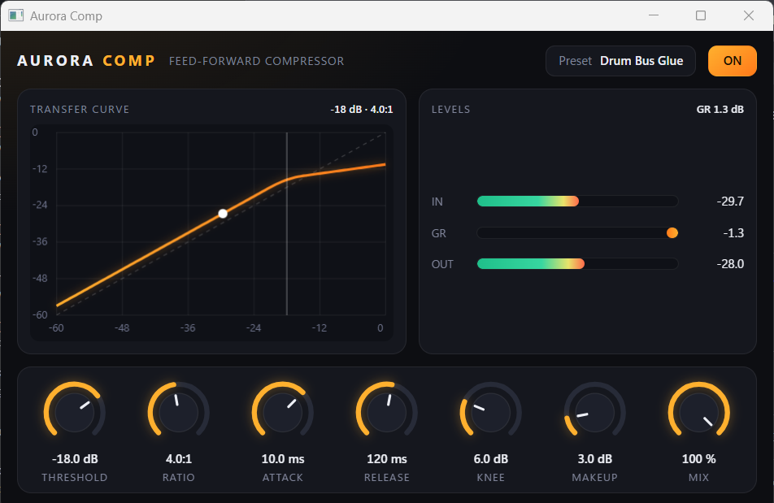
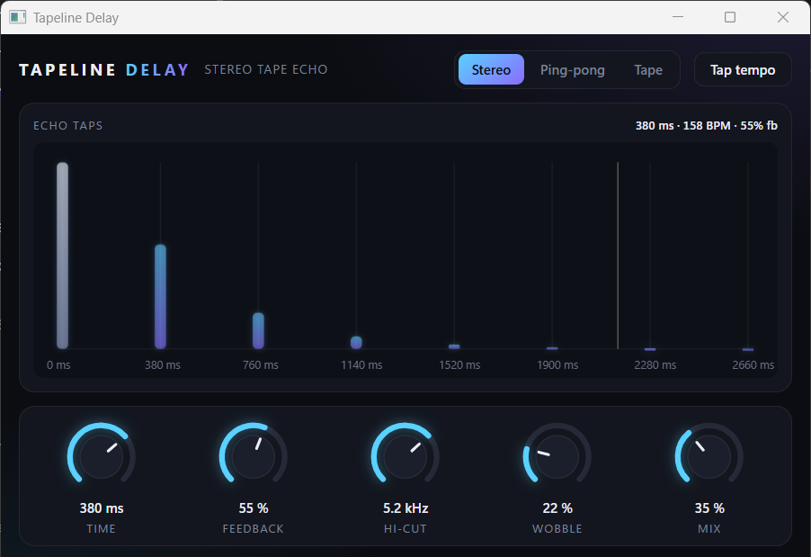

# ReaGlass

**Interfaces em HTML, CSS e JavaScript para scripts Lua do REAPER.**

> English: [README.md](README.md)

O ReaGlass é uma extensão do REAPER que permite a um script Lua abrir uma janela cuja interface é uma página web.
Monte o seu painel com as ferramentas que você já conhece e converse com o REAPER por uma pequena ponte de mensagens.

```lua
local win = reaper.RG_Create("meu_painel", "Meu painel", 400, 300, false)
reaper.RG_Navigate(win, "file:///C:/caminho/para/ui.html")
-- Lua -> página:  reaper.RG_Send(win, "evento", "texto")
-- página -> Lua:  reaper.RG_Poll(win) / reaper.RG_Payload(win)
```

```js
reaper.send('ping', 'oi');                       // página -> Lua
reaper.on('pong', texto => console.log(texto));  // Lua -> página
```

## Capturas de tela

Plugins fictícios feitos com o ReaGlass, rodando dentro do REAPER (a interface é só HTML, CSS e JS):





## Status

| Plataforma | Motor | Estado |
|---|---|---|
| Windows | WebView2 (Chromium) | Funcionando |
| macOS | WKWebView | Planejado |
| Linux | WebKitGTK | Planejado |

O plugin é pequeno (~280 KB) porque usa o motor de navegador que já existe no sistema operacional.

## Instalação

1. Baixe `ReaGlass-*-windows-x64.zip` na [última release](https://github.com/flnascimento/ReaGlass/releases/latest) e descompacte.
2. Copie `reaper_reaglass-x64.dll` para a pasta `UserPlugins` do REAPER (REAPER → Options → Show REAPER resource path → `UserPlugins`).
3. Reinicie o REAPER. `reaper.RG_Create` passa a existir.
4. Requer o Microsoft Edge WebView2 Runtime (já incluído no Windows 10/11).

## Aprenda pelos exemplos

- [`examples/hello`](examples/hello): ponte de mão dupla mínima.
- [`examples/compressor`](examples/compressor): *Aurora Comp*, interface de compressor com knobs, curva de transferência e medidores.
- [`examples/delay`](examples/delay): *Tapeline Delay*, interface de delay de fita com knobs, visualização dos ecos e tap tempo.
- [`examples/track_colors`](examples/track_colors): um painel que lê o estado do projeto e colore tracks.
- [`docs/API.pt-BR.md`](docs/API.pt-BR.md): referência completa da API.

## Para assistentes de IA

Aponte qualquer IA para [`AGENTS.md`](AGENTS.md) / [`llms.txt`](llms.txt), ou anexe [`docs/API.pt-BR.md`](docs/API.pt-BR.md) ao seu pedido.
Ele traz a API inteira, o protocolo de mensagens e as armadilhas, para que os scripts gerados funcionem de primeira.
Há uma skill do Claude Code em [`.claude/skills/reaglass`](.claude/skills/reaglass).

## Compilar (Windows)

Requer Visual Studio 2022 Build Tools e Git.

```powershell
powershell -ExecutionPolicy Bypass -File scripts\fetch-deps.ps1   # baixa deps/ nas versões testadas
build.bat
```

Feche o REAPER antes de recompilar: o Windows trava a DLL carregada.

## Agradecimentos

- [webview/webview](https://github.com/webview/webview) (MIT), de Serge Zaitsev e Steffen André Langnes: compilado no plugin para hospedar o motor de navegador.
- Microsoft Edge WebView2 (headers do SDK, BSD-3-Clause): o motor baseado em Chromium usado no Windows.
- [SDK do REAPER](https://github.com/justinfrankel/reaper-sdk), da Cockos Incorporated (licença estilo zlib).
- [ReaImGui](https://github.com/cfillion/reaimgui), de Christian Fillion: a inspiração, e uma ótima opção para quem quer interface no estilo ImGui.

## Licença

[MIT](LICENSE): use, altere, faça forks e redistribua, mantendo o aviso de copyright (o crédito).
Licenças de terceiros: [THIRD_PARTY_NOTICES.md](THIRD_PARTY_NOTICES.md).

"REAPER" é marca da Cockos Incorporated. O ReaGlass é independente e não é afiliado nem endossado pela Cockos.
